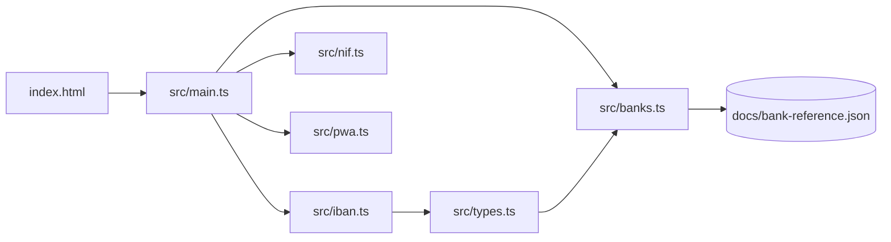

# Architecture

IBAN Fresquinho is a static single-page app written in plain TypeScript and built with Vite. There is no framework, backend or network call at runtime: everything happens in the browser.

## Layers

| Layer          | Files                                 | Rules                                                                                                                                                       |
| -------------- | ------------------------------------- | ----------------------------------------------------------------------------------------------------------------------------------------------------------- |
| Domain         | `iban.ts`, `nif.ts`                   | Pure functions, no DOM. Invalid input throws `RangeError`. Batches are unique and give up after `count × 10` attempts instead of returning a partial batch. |
| Reference data | `banks.ts`, `bank-reference.json`     | A dated, immutable snapshot of the Banco de Portugal list. See [iban-reference.md](iban-reference.md).                                                      |
| Interface      | `main.ts`, `index.html`, `styles.css` | Owns all state and DOM work. Writes text with `textContent` only.                                                                                           |
| Offline        | `pwa.ts`, `vite.config.ts`            | Registers the service worker in production builds and asks before applying updates.                                                                         |

Randomness comes from `Math.random`. That is enough for test-data variety; the values are not secrets and must not be used as such.

## Interface (`src/main.ts`)

### Start-up

`init()` runs once (a guard protects against double initialisation). It renders Lucide icons into every `[data-icon]` slot, applies the theme, wires events, builds the bank list and generates the first IBAN, so the page never opens empty.

### State

| Variable        | Holds                                                                        |
| --------------- | ---------------------------------------------------------------------------- |
| `activeTool`    | `'iban'` or `'nif'`                                                          |
| `toolStates`    | Per tool: current results, raw quantity text, error message and invalid flag |
| `selectedCodes` | IBAN bank selection, shared by the shortcut buttons and the full list        |
| `nifCategory`   | NIF profile for the next generation                                          |
| `copyRequest`   | Counter that identifies the latest clipboard request                         |

Choices (banks, profile, quantity) apply to the next generation only. Results keep the labels they were generated with.

Only the theme is persisted (`localStorage` key `iban-theme`). Everything else is lost on reload by design.

### Switching tools

The title reads `<PREFIX> Fresquinho`. The prefix is a disclosure button (`#tool-prefix`) that opens a list of tool buttons (`#tool-menu`). This is the WAI-ARIA disclosure pattern, not an ARIA menu: options are ordinary buttons marked with `aria-current`. Arrow keys, Home and End move between options; Escape closes and returns focus; Tab or a click outside closes.

`switchTool(next)`:

1. Saves the current tool's raw quantity, error and invalid flag.
2. Cancels any copy feedback, so a slow clipboard response cannot appear on the other tool.
3. Restores the next tool's state and batch limit.
4. Shows `<tool>-controls`, `<tool>-validity` and `<tool>-about`; hides the others.
5. Updates the prefix text and the footer button.
6. Generates one result on the first visit only; later visits redraw the stored results without using randomness.

### Generating and rendering

`generateResults()` validates the quantity, calls `generateIdentifiers()` for the active tool and passes the result to `renderResults()`. On failure, the previous results stay visible and an error is shown. A screen-reader status announces each new batch.

### Clipboard

`copyResult()` writes only after a click. Each request increments `copyRequest`; when the browser answers, the response is ignored if a newer request, a new generation or a tool switch has happened since. If the browser refuses or lacks the Clipboard API, the values appear pre-selected in a read-only text area, and focus returns to the original button when it closes.

### Bank picker

A native `<dialog>`. Its 108 rows ("Qualquer banco" plus 107 codes) are built once and then filtered by toggling `hidden`, which keeps search fast on low-end machines. Search ignores case and accents.

### Footer button

`#sunflower-trigger` has intentional hidden behaviour with per-tool content, defined near the top of `main.ts` and covered by tests. Keep it when refactoring.

### Motion

`animateFeedback()` wraps the Web Animations API. Animations are short and finite, and none run when the user prefers reduced motion. Tests assert both.

## Styling (`src/styles.css`)

Tailwind provides the reset and the `sr-only` utility; components are plain CSS. Colours, lines and surfaces are custom properties in `:root` and `:root[data-theme='dark']`, so both themes share one set of rules. The design rules are listed in [maintaining.md](maintaining.md#design-rules).

## Offline and updates

`vite-plugin-pwa` generates the service worker and precaches the built assets, fonts and images. `pwa.ts` shows "Nova versão disponível" when a new worker is waiting, and only activates and reloads after the user agrees, because reloading clears current results.

## Security

The Content Security Policy in `vercel.json` allows only same-origin scripts, styles, fonts and connections. The one inline script, the JSON-LD block in `index.html`, is allowed by its SHA-256 hash. `vite preview` reuses the same headers, so local previews behave like production. Details and limits are in [SECURITY.md](../SECURITY.md).

## Tests (`src/__tests__/`)

| Suite              | Covers                                                                                                  |
| ------------------ | ------------------------------------------------------------------------------------------------------- |
| `iban.test.ts`     | Algorithms against a SWIFT vector and independent `BigInt` calculations, invalid input, collisions      |
| `nif.test.ts`      | All 11 checksum remainders, profiles, batch limits, collisions                                          |
| `banks.test.ts`    | Catalogue counts, source metadata and the default-generation policy                                     |
| `main.test.ts`     | The real `index.html` in jsdom, driven through DOM events: switching, state, clipboard, picker, dialogs |
| `pwa.test.ts`      | Update prompt and reload behaviour                                                                      |
| `security.test.js` | pnpm settings, exact dependency versions, headers, the CSP hash and workflow pinning                    |
